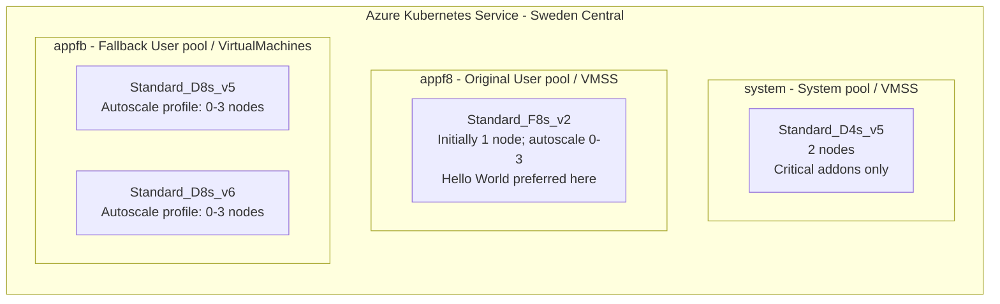

# AKS Capacity Toolkit

This non-production lab tests the AKS Virtual Machine (VM) node pools feature as a way to mitigate temporary Azure capacity shortages. It is inspired by the AKS product group's article, [Navigating Capacity Challenges on AKS with Node Auto Provisioning or Virtual Machine Node Pools | AKS Engineering Blog](https://blog.aks.azure.com/2025/12/06/node-auto-provisioning-capacity-management). This lab explores the VM node pools approach, not Node Auto Provisioning (NAP).

The lab has two stages:

1. **Reproduce a common customer starting point.** Deploy an AKS cluster with a Hello World application running on a Virtual Machine Scale Sets (VMSS) User node pool using `Standard_F8s_v2`. Terraform creates the resource group, cluster, and original pools with default autoscaler settings; the baseline Kubernetes manifest pins the application to that User pool. Verify that the application is running before changing the architecture.
2. **Add a capacity fallback to the existing cluster.** Create an additional VM-based User node pool (`VirtualMachines` type) that supports multiple VM SKUs: `Standard_D8s_v5` and `Standard_D8s_v6`. Enable the cluster autoscaler's priority expander, apply its priority ConfigMap, and update the application's scheduling rules to allow both pools while preferring the original VMSS pool. The fallback pool starts at zero nodes and is intended to provide alternative SKUs during temporary capacity shortages, rather than serve as the normal application pool.

The goal is to test capacity resilience without replacing the original pool or enabling NAP. Fallback is not a capacity guarantee: a zero-node pool does not reserve Azure capacity, and fallback nodes may remain in use until normal autoscaler scale-down and workload scheduling allow their removal.

The repository provides Terraform, Kubernetes, and PowerShell examples for the full exercise. There is no application repository to clone, image to build, or registry to create.

Only mocked/offline checks are intended for local validation without Azure access. Live deployment and the fallback exercise are opt-in operations that can create billable resources; verify current regional, provider, image, and CLI extension availability before use.

## Technical concepts used in this lab

### Why enable the priority expander?

The AKS cluster autoscaler adds nodes when pods cannot be scheduled onto existing nodes. When more than one node pool could satisfy those pods, an **expander** determines which scale-up option to prefer. Adding a fallback pool alone does not tell the autoscaler to favor the original pool.

This lab enables the **priority expander** so that `appf8` is preferred over `appfb` when both are eligible scale-up options. If the primary pool cannot grow, for example because it has reached its configured limit or provisioning has failed, the autoscaler can consider fallback capacity. Allocation failures involve retries, timeouts, and backoff; this is not an immediate or guaranteed failover mechanism. The autoscaler responds to unschedulable pods, not directly to HTTP traffic.

### Why use a ConfigMap for priorities?

Enabling `--expander priority` selects the autoscaler's decision strategy; it does not define the preferred pools. The strategy reads its rules from a ConfigMap named `cluster-autoscaler-priority-expander` in the `kube-system` namespace.

The [priority ConfigMap](./k8s/vm-node-pools/cluster-autoscaler-priority-expander.yaml) maps numeric priorities to regular expressions matching autoscaler node-group names:

| Priority | Name pattern | Purpose |
| --- | --- | --- |
| `50` | `.*appf8.*` | Prefer scaling the original application pool |
| `10` | `.*appfb.*` | Use the fallback pool as a lower-priority scale-up option |

**Higher numbers mean higher priority.** These rules express a preference between the primary and fallback pools; they do not define an order between the two fallback SKUs. Both enabling the expander and applying its ConfigMap are required to implement this policy. See the [AKS cluster autoscaler overview](https://learn.microsoft.com/en-us/azure/aks/cluster-autoscaler-overview) for background.

### Why use a VM node pool for multiple SKUs?

The original `VirtualMachineScaleSets` (VMSS) application pool uses one configured VM SKU, `Standard_F8s_v2`. To offer multiple SKUs **within one AKS node pool**, this lab adds a `VirtualMachines` pool instead of another single-SKU VMSS pool.

A VM node pool supports multiple compatible, same-family VM SKUs through scale profiles, with up to five profiles per pool. Here, `appfb` has one autoscale profile for `Standard_D8s_v5` and another for `Standard_D8s_v6`, each with a minimum of 0 and a maximum of 3 nodes. This gives the autoscaler alternative capacity options without requiring a separate AKS pool for each SKU. The two profiles can grow to six nodes in total; they do not reserve either SKU.

This is an AKS-managed node pool, not a collection of VMs managed independently of AKS. The existing VMSS pool stays in place, and the cluster continues using the standard cluster autoscaler rather than NAP. See [VirtualMachines mixed-SKU node pools](https://learn.microsoft.com/en-us/azure/aks/virtual-machines-node-pools) for compatibility requirements and limitations.

### How do pod scheduling rules allow fallback?

Autoscaler priorities control **which pool to grow**. Kubernetes node affinity controls **where pods may run**. The baseline application is pinned to `appf8`; leaving that hard restriction in place would prevent `appfb` from helping it.

In section 8, the [target application manifest](./k8s/vm-node-pools/hello-world.yaml) allows both `appf8` and `appfb`, while retaining a soft preference for `appf8`. The `system` pool remains dedicated to critical addons. Ready fallback nodes can still receive pods even when the primary pool could grow, and neither soft affinity nor expander priorities automatically move running pods back to primary.

## Lab architecture

The diagram shows the **target architecture after section 8**. Only `system` and `appf8` exist in the Terraform baseline; `appfb` is added to that existing cluster through Azure CLI.



`appfb` starts with zero nodes across both profiles. Its boxes represent configured SKU options, not pre-provisioned VMs. Scale-up preference is `appf8` (priority 50) before `appfb` (priority 10); Hello World is eligible for either User pool after section 8.

An [editable draw.io version](./docs/diagrams/aks-node-pools.drawio) is also provided.

## Walkthrough order

1. **Baseline example environment (sections 1-7):** deploy Terraform, connect, deploy `k8s/baseline`, and verify primary-only placement and public HTTP.
2. **Change the existing cluster (section 8):** check prerequisites, enable the priority expander, apply its ConfigMap, create/verify `appfb`, and apply `k8s/vm-node-pools/hello-world.yaml` to update the existing application.
3. **Target-environment operations (sections 9-10):** scale to zero/restore and optionally exercise fallback.

All of section 8 is completed through CLI commands (Azure CLI and kubectl), because these changes are applied on top of the existing Terraform-deployed environment rather than through changes to Terraform. The table below describes the completed target architecture; the fallback rows do not exist during the baseline phase.

| Component | Configuration |
| --- | --- |
| Resource group and AKS | `swedencentral` |
| Control plane | AKS Free tier |
| System pool | Two `Standard_D4s_v5` Ubuntu nodes, critical-addons-only |
| Application pool | `appf8`, `Standard_F8s_v2`, Linux, User mode |
| User node scaling | Standard AKS cluster autoscaler, minimum 0, maximum 3, initially 1 |
| Fallback pool | CLI-managed `appfb`, `VirtualMachines` type, Ubuntu, User mode; `Standard_D8s_v5` and `Standard_D8s_v6` |
| Fallback scaling | Two autoscale profiles, each minimum 0 and maximum 3; initially 0 nodes, up to 6 fallback nodes total |
| Scale-up preference | Enabled after baseline deployment through CLI; priority ConfigMap prefers `appf8` before `appfb` |
| Node provisioning | Explicit `Manual` mode; no NAP or Karpenter |
| Networking | Azure CNI Overlay, Standard Load Balancer, load-balancer outbound connectivity |
| Administration | Microsoft Entra ID and Azure RBAC; local accounts disabled |
| Application endpoint | Public IP, HTTP port 80 |

This is a demo, not a production baseline: no HTTPS, ingress controller, CI/CD, dedicated monitoring, or availability SLA. HTTP traffic is unencrypted. Do not put credentials or sensitive data into the app. Individual nodes do not have public IPs.

## Files

- [main.tf](./main.tf): Azure resources and administrator role assignments.
- [variables.tf](./variables.tf): validated deployment inputs.
- [terraform.tfvars.example](./terraform.tfvars.example): example inputs.
- [k8s/baseline/hello-world.yaml](./k8s/baseline/hello-world.yaml): baseline example application, pinned to `appf8`.
- [k8s/vm-node-pools/hello-world.yaml](./k8s/vm-node-pools/hello-world.yaml): target application, eligible for `appf8` and `appfb`, preferring `appf8`.
- [k8s/vm-node-pools/cluster-autoscaler-priority-expander.yaml](./k8s/vm-node-pools/cluster-autoscaler-priority-expander.yaml): target managed-autoscaler pool priorities.
- [tests/infrastructure.tftest.hcl](./tests/infrastructure.tftest.hcl): mocked infrastructure tests; no Azure resources are created.
- [scripts/Test-AksFallback.ps1](./scripts/Test-AksFallback.ps1): opt-in non-production fallback exercise with isolated demand pods and automatic cleanup/restoration.
- [tests/fallback-exercise.tests.ps1](./tests/fallback-exercise.tests.ps1): offline regression checks for exercise preflights, placement verification, and restoration. Run with `pwsh -NoProfile -File .\tests\fallback-exercise.tests.ps1`; no Azure access is used.

Both application manifests define the **same** namespace, ConfigMaps, Deployment, and Service names. Apply the target manifest over the baseline to update those resources in place; do not delete the baseline first. Only the scheduling rules and explanatory page text differ. Never apply the entire `k8s` tree recursively: the two application variants represent alternative stages, not separate applications.

## 1. Prerequisites and permissions

Install Terraform 1.7 or later (less than 2.0), Azure CLI, kubectl, and [kubelogin](https://azure.github.io/kubelogin/install.html). The provider is constrained to AzureRM 5.9.x; retain the generated provider lock file. It does not expose the required mixed-SKU pool schema, so the fallback pool is deliberately CLI-managed rather than a Terraform node-pool resource.

VirtualMachines pools require Kubernetes 1.27 or newer and compatible same-family SKUs, with at most five scale profiles. These requirements apply to the target phase, not baseline application deployment. The two selected SKUs are x86 D-series VMs. Check the CLI command availability in section 8a; a version number alone is not sufficient. No preview feature registration is assumed. If adapting this example to a custom VNet, check the [VirtualMachines pool identity requirements](https://learn.microsoft.com/en-us/azure/aks/virtual-machines-node-pools#prerequisites); this example uses AKS-managed networking.

Use an existing Microsoft Entra security group in the subscription's tenant. Your administrator must be a member of that group; provide its **object ID**, not its display name or an application/client ID.

The Terraform deployment identity needs:

- Permission to create resource groups, AKS, nodes, and networking in the selected subscription (for example, Contributor).
- Permission to create/delete Azure role assignments (for example, Role Based Access Control Administrator, with any assignment conditions allowing the required roles and groups). Owner combines these abilities but is broader than necessary.
- Permission to register resource providers if they are not already registered.

Terraform grants each selected group these roles at the AKS resource scope:

- **Azure Kubernetes Service RBAC Cluster Admin**: administer Kubernetes resources.
- **Azure Kubernetes Service Cluster User Role**: retrieve the non-admin kubeconfig.

No Entra groups are created, and no local `--admin` kubeconfig is enabled.

Commands below use **PowerShell**, run from the repository root. Do not continue past a failed command. Set your subscription explicitly:

```powershell
az login
$SubscriptionId = "<your-azure-subscription-uuid>"
az account set --subscription $SubscriptionId
az account show --query '{subscription:id, tenant:tenantId, name:name}' -o table
```

Provider auto-registration is disabled to avoid hidden subscription-wide changes. Check these providers, and register only those not already registered:

```powershell
$Providers = @(
  "Microsoft.ContainerService",
  "Microsoft.Compute",
  "Microsoft.Network",
  "Microsoft.ManagedIdentity"
)
foreach ($Provider in $Providers) {
  $State = az provider show --namespace $Provider --query registrationState -o tsv
  if ($LASTEXITCODE -ne 0) { throw "Cannot inspect provider $Provider" }
  if ($State -ne "Registered") {
    az provider register --namespace $Provider --wait
    if ($LASTEXITCODE -ne 0) { throw "Cannot register provider $Provider" }
  }
}
```

## 2. Check Sweden Central availability and quota

These are read-only checks against your selected subscription:

```powershell
az vm list-skus --location swedencentral --resource-type virtualMachines --size Standard_F8s_v2 --all --query "[?name=='Standard_F8s_v2'].{name:name,restrictions:restrictions}" -o json
az vm list-skus --location swedencentral --resource-type virtualMachines --size Standard_D4s_v5 --all --query "[?name=='Standard_D4s_v5'].{name:name,restrictions:restrictions}" -o json
az vm list-skus --location swedencentral --resource-type virtualMachines --size Standard_D8s_v5 --all --query "[?name=='Standard_D8s_v5'].{name:name,restrictions:restrictions}" -o json
az vm list-skus --location swedencentral --resource-type virtualMachines --size Standard_D8s_v6 --all --query "[?name=='Standard_D8s_v6'].{name:name,restrictions:restrictions}" -o json
az vm list-usage --location swedencentral -o table
az aks get-versions --location swedencentral -o table
```

An empty SKU result or a location restriction means you must resolve availability before deployment. The configuration does not silently substitute a SKU or region. Inspect subscription policy too: a policy may prohibit the Free tier, public networking, these VM sizes, or the region. Available quota does not guarantee real-time Azure capacity; a zero-node fallback pool does not reserve capacity.

Capacity to allow for (only the first two pools exist in the baseline):

- Two D4s_v5 system nodes: **8 Dsv5-family vCPUs**.
- Three F8s_v2 user nodes: **24 Fsv2-family vCPUs**.
- Three D8s_v5 fallback nodes: **24 Dsv5-family vCPUs**, in addition to the system pool.
- Three D8s_v6 fallback nodes: **24 Dsv6-family vCPUs**.
- At these limits, the three pools can use **80 regional vCPUs** before upgrade headroom. Allow an additional **4 Dsv5** and **8 Fsv2** vCPUs for the original pools' surge nodes, plus fallback upgrade headroom in either candidate family. Inspect the fallback pool's upgrade settings and allow conservative headroom in both families. Allow for managed disks and networking quota too.

If no Kubernetes version is supplied, AKS chooses its recommended version at creation. Patch auto-upgrades and NodeImage OS upgrades are enabled. If supplying a version, choose a supported GA version from the regional command above; do not use a preview. Review minor-version upgrades explicitly before support expires.

## 3. Configure Terraform

```powershell
Copy-Item .\terraform.tfvars.example .\terraform.tfvars
```

Edit `terraform.tfvars` and supply your deployment values:

- `subscription_id`: the subscription selected above.
- `admin_group_object_ids`: one or more existing Entra security-group UUIDs.
- `api_server_authorized_ip_ranges`: your operator's **public egress IPv4 CIDRs**, typically `x.x.x.x/32`. Include any VPN/NAT egress addresses needed to manage AKS. Do not enter your workstation's private LAN IP.

The API allowlist restricts **cluster management**, not the public Hello World endpoint. An unrestricted `/0` management range is rejected. If your egress address changes, update the input and apply Terraform before reconnecting. Keep a trusted recovery path with permission to update the cluster.

The region and original pool SKUs are intentionally fixed. The CLI fallback instructions specify the two additional SKUs and independent per-profile bounds. The original scaling object defaults to:

```hcl
user_pool_scaling = {
  min_count     = 0
  max_count     = 3
  initial_count = 1
}
```

`initial_count` only affects pool creation. Terraform ignores subsequent `node_count` drift so it does not fight the cluster autoscaler. Terraform still manages the autoscaler bounds and other pool settings.

## 4. Validate and deploy infrastructure

Static validation and mocked tests do not provision Azure resources:

```powershell
terraform init
terraform fmt -check -recursive
terraform validate
terraform test
```

Review an authenticated plan before creating resources:

```powershell
terraform plan "-out=aks.tfplan"
```

**The following command creates billable resources. Run it only after checking the plan, access, quota, and costs:**

```powershell
terraform apply .\aks.tfplan
Remove-Item .\aks.tfplan
```

Azure creates a separate AKS-managed node resource group containing VM scale sets, disks, load-balancer resources, and public IPs. It is expected in addition to the resource group defined in Terraform.

By default, Terraform state is local. Keep it backed up and protected: AKS resource state can contain sensitive information even though no kubeconfig is output. Actual variable files, state, and saved plans are ignored by Git. For shared use, configure an access-controlled Azure Storage backend with state locking before deployment; do not commit state or credentials.

## 5. Connect using Entra ID

Use a dedicated kubeconfig and context so commands do not accidentally affect an unrelated cluster:

```powershell
$ResourceGroup = terraform output -raw resource_group_name
if ($LASTEXITCODE -ne 0) { throw "Cannot read resource group output" }
$Cluster = terraform output -raw cluster_name
if ($LASTEXITCODE -ne 0) { throw "Cannot read cluster output" }
$Pool = terraform output -raw user_pool_name
if ($LASTEXITCODE -ne 0) { throw "Cannot read user-pool output" }
$Context = "$Cluster-demo"

New-Item -ItemType Directory -Path .\.kube -Force | Out-Null
$env:KUBECONFIG = Join-Path (Get-Location).Path ".kube\config"
az aks get-credentials --resource-group $ResourceGroup --name $Cluster --file $env:KUBECONFIG --context $Context --overwrite-existing
if ($LASTEXITCODE -ne 0) { throw "Cannot obtain AKS credentials" }
kubelogin convert-kubeconfig -l azurecli
if ($LASTEXITCODE -ne 0) { throw "Cannot configure Entra authentication" }
kubectl --context $Context get nodes
```

Azure RBAC assignments and group membership changes can take time to propagate. If you get `Forbidden`, verify your group membership, subscription/tenant, role assignments, and authentication, then retry after propagation. A timeout reaching the API usually indicates a wrong egress allowlist or network/firewall issue. Do not fall back to admin credentials.

## 6. Deploy the baseline example application

At this stage there is no `appfb` pool, priority ConfigMap, or explicitly configured autoscaler expander. Keep the AKS autoscaler defaults from the Terraform baseline.

Create the namespace first because server-side dry-run does not persist it. Paste the entire block so a failed step stops subsequent commands:

```powershell
& {
  if ([string]::IsNullOrWhiteSpace($Context)) { throw "Context is empty; complete section 5 first" }
  kubectl --context $Context create namespace hello-world --dry-run=client -o yaml | kubectl --context $Context apply -f -
  if ($LASTEXITCODE -ne 0) { throw "Cannot create application namespace" }
  kubectl --context $Context apply --dry-run=server -f .\k8s\baseline\hello-world.yaml
  if ($LASTEXITCODE -ne 0) { throw "Baseline application manifest validation failed" }
  kubectl --context $Context apply -f .\k8s\baseline\hello-world.yaml
  if ($LASTEXITCODE -ne 0) { throw "Baseline application deployment failed" }
  kubectl --context $Context -n hello-world rollout status deployment/hello-world --timeout=15m
  if ($LASTEXITCODE -ne 0) { throw "Baseline application rollout failed" }
}
```

The baseline pod requires both `kubernetes.azure.com/agentpool=appf8` and `workload=hello-world`. It cannot use a fallback pool or the system pool. NGINX runs as UID/GID 101 on port 8080 with a read-only root filesystem, a writable temporary volume, dropped capabilities, probes, and resource bounds.

## 7. Verify the original environment before making changes

Inspect the original pools and actual pod placement:

```powershell
az aks show --resource-group $ResourceGroup --name $Cluster --query '{location:location,provisioning:nodeProvisioningProfile.mode,tier:sku.tier,autoscaler:autoScalerProfile}' -o json
az aks nodepool list --resource-group $ResourceGroup --cluster-name $Cluster --query '[].{name:name,mode:mode,vmSize:vmSize,count:count,autoscaler:enableAutoScaling,min:minCount,max:maxCount}' -o table
kubectl --context $Context -n hello-world get deployment hello-world -o jsonpath='{.spec.template.spec.nodeSelector}'
kubectl --context $Context get nodes -L kubernetes.azure.com/agentpool,node.kubernetes.io/instance-type,workload
kubectl --context $Context -n hello-world get pods -o wide
kubectl --context $Context -n hello-world get service hello-world --watch
```

Confirm Sweden Central, `Manual` provisioning, the system pool, and `appf8` using `Standard_F8s_v2` with autoscaler bounds 0-3. Match the Ready application's `NODE` to `appf8`. There should be no `appfb` or explicitly configured `priority` expander yet; if these already exist, this cluster is already beyond the original baseline. Do not reset an existing cluster just to repeat the walkthrough.

Wait for `EXTERNAL-IP` to become an IPv4 address, then press Ctrl+C to stop watching. Retrieve it and verify the application from outside the cluster:

```powershell
$PublicIp = kubectl --context $Context -n hello-world get service hello-world -o jsonpath='{.status.loadBalancer.ingress[0].ip}'
if ($LASTEXITCODE -ne 0 -or [string]::IsNullOrWhiteSpace($PublicIp)) {
  throw "The Service does not yet have a public IP; inspect its events and retry."
}
$Url = "http://$PublicIp"
$Response = Invoke-WebRequest -Uri $Url -TimeoutSec 30
if ($Response.StatusCode -ne 200 -or $Response.Content -notmatch '<h1>Hello World!</h1>') {
  throw "The baseline endpoint did not return the expected Hello World page."
}
Write-Output "Verified baseline public endpoint: $Url"
```

Browse to the printed URL. The baseline page states that the application runs on the F8s_v2 user pool. The public IP is allocated by AKS, is not known from Terraform alone, and can change if the Service or cluster is recreated.

**Baseline checkpoint:** proceed only after Hello World is Ready on `appf8` and public HTTP succeeds. If these fail, resolve the original environment before enabling fallback.

## 8. Change the existing cluster to the VM Node Pool architecture

**These commands change billable Azure resources or cluster configuration. Run them yourself after reviewing the subscription, quota, and target cluster.** Use `$ResourceGroup`, `$Cluster`, `$Pool`, `$Context`, and `$Url` from the baseline phase. Complete sections 6-7 first. Do not apply Terraform to enable priority: the desired-environment changes are deliberately separate from the baseline example.

The order is: **8a preflight; 8b enable the priority expander; 8c apply the priority ConfigMap; 8d create/verify the fallback pool; 8e update the existing application; 8f verify the target environment**. Keep the application pinned to `appf8` until step 8e.

### 8a. Check the CLI and existing cluster first

**Azure CLI 2.88.0 without `aks-preview` cannot run this workflow.** Its pool creation path sends VMSS-only `enableAutoScaling`, `minCount`, and `maxCount` fields, which Azure rejects for `VirtualMachines`. This does not prove VirtualMachines pools cannot autoscale: their limits belong under `virtualMachinesProfile.scale.autoscale`. The published `aks-preview` **21.0.0b10** extension uses that profile schema and provides `auto-scale add/update/delete`; its minimum CLI version is **2.85.0**.

Explicitly install this extension before creating the pool. The following changes your local CLI installation, not Azure resources. If you already have `aks-preview`, inspect its version and update it explicitly rather than assuming its older commands support this workflow:

```powershell
& {
  $env:AZURE_EXTENSION_USE_DYNAMIC_INSTALL = "no"
  $ExtensionsJson = az extension list -o json
  if ($LASTEXITCODE -ne 0) { throw "Cannot inspect installed extensions" }
  $AksPreview = ($ExtensionsJson | ConvertFrom-Json) | Where-Object { $_.name -eq "aks-preview" }
  if ($null -eq $AksPreview) {
    az extension add --name aks-preview --version 21.0.0b10 --allow-preview true
    if ($LASTEXITCODE -ne 0) { throw "aks-preview installation failed; do not create the pool" }
  } else {
    Write-Output "Installed aks-preview version: $($AksPreview.version)"
    if ($AksPreview.version -ne "21.0.0b10") {
      throw "An existing different aks-preview version requires review. Update it explicitly with az extension update --name aks-preview, then check command availability and VirtualMachines autoscale support."
    }
  }
  az extension show --name aks-preview --query '{name:name,version:version}' -o json
  if ($LASTEXITCODE -ne 0) { throw "Cannot verify aks-preview installation" }
}
```

Review the preview extension's implications before installation. The pinned published release was inspected for creation-profile serialization and command registration; it has not been deployed against your subscription. A later release may work too, but review its support before substituting it. Upgrading core CLI alone is not a verified fix for this particular environment.

Now check both commands and the target cluster without automatic extension installation. Keep the script block intact: a thrown error stops the rest of the block even when pasted into an interactive PowerShell console.

```powershell
& {
  $env:AZURE_EXTENSION_USE_DYNAMIC_INSTALL = "no"
  az version
  if ($LASTEXITCODE -ne 0) { throw "Cannot inspect Azure CLI" }
  az aks nodepool add --help | Out-Null
  if ($LASTEXITCODE -ne 0) { throw "Node-pool creation command is unavailable" }
  az aks nodepool auto-scale add --help | Out-Null
  if ($LASTEXITCODE -ne 0) { throw "Autoscale-profile command is unavailable; do not create the pool" }
  az aks show --resource-group $ResourceGroup --name $Cluster --query '{version:currentKubernetesVersion,location:location,provisioning:provisioningState}' -o json
  if ($LASTEXITCODE -ne 0) { throw "Cannot inspect the target cluster" }
}
```

Confirm Kubernetes 1.27 or newer, Sweden Central, and `Succeeded` provisioning. Repeat the SKU/quota checks from section 2 against the selected subscription.

At this point, `appfb` has not been created. This step checks prerequisites only. Next enable the priority expander in step 8b, apply its ConfigMap in step 8c, and then create the fallback pool in step 8d.

### 8b. Enable the priority expander through CLI

Update the managed cluster's autoscaler profile without changing Terraform. This modifies the existing cluster in place; it does not create another autoscaler or recreate the original pools. Keep the script block intact so an update failure stops verification:

```powershell
& {
  az aks update `
    --resource-group $ResourceGroup `
    --name $Cluster `
    --cluster-autoscaler-profile expander=priority balance-similar-node-groups=false
  if ($LASTEXITCODE -ne 0) { throw "Priority expander update failed; inspect the Azure error before continuing" }

  az aks show --resource-group $ResourceGroup --name $Cluster --query autoScalerProfile -o json
  if ($LASTEXITCODE -ne 0) { throw "Cannot verify managed autoscaler settings" }
}
```

Confirm the returned profile has `"expander": "priority"` and `balanceSimilarNodeGroups` set to false (AKS may display this as the string `"false"`). The CLI flag uses the hyphenated key `balance-similar-node-groups`; the returned JSON uses `balanceSimilarNodeGroups`. Do not pass an empty profile, which clears the settings.

The application is still pinned to `appf8`, and the fallback pool does not exist yet. Enabling the expander alone does not define the pool ranking; complete step 8c immediately before creating the fallback pool.

### 8c. Apply the priority ConfigMap

```powershell
& {
  if ([string]::IsNullOrWhiteSpace($Context)) { throw "Context is empty; complete section 5 first" }
  kubectl --context $Context apply --dry-run=server -f .\k8s\vm-node-pools\cluster-autoscaler-priority-expander.yaml
  if ($LASTEXITCODE -ne 0) { throw "Autoscaler priority manifest validation failed" }
  kubectl --context $Context apply -f .\k8s\vm-node-pools\cluster-autoscaler-priority-expander.yaml
  if ($LASTEXITCODE -ne 0) { throw "Autoscaler priority configuration failed" }
  kubectl --context $Context -n kube-system get configmap cluster-autoscaler-priority-expander -o yaml
  if ($LASTEXITCODE -ne 0) { throw "Cannot inspect autoscaler priorities" }
}
```

Higher numbers mean greater priority: 50 for `.*appf8.*`, 10 for `.*appfb.*`. The ConfigMap defines the priorities but does **not** enable the expander; step 8b does that. It can refer to `appfb` before the pool exists. Patterns match **autoscaler node-group identifiers**, not pod labels. Verify all group identifiers after creating the fallback profiles in step 8d. No preference between the two fallback SKUs is specified.

### 8d. Create the pool and its two autoscale profiles

This block is safe to rerun after partial completion or a successful run. It creates `appfb` only if missing, waits for ongoing updates, and adds only missing autoscale profiles. Existing profiles with the expected 0-3 bounds are left unchanged. It stops on incompatible configuration rather than deleting resources, replacing profiles, or silently changing existing bounds. Complete section 5 first so `$ResourceGroup` and `$Cluster` identify the intended cluster.

```powershell
$FallbackPool = "appfb"
& {
  if ([string]::IsNullOrWhiteSpace($ResourceGroup) -or [string]::IsNullOrWhiteSpace($Cluster)) {
    throw "ResourceGroup or Cluster is empty; complete section 5 first"
  }
  $env:AZURE_EXTENSION_USE_DYNAMIC_INSTALL = "no"
  $ExtensionVersion = az extension show --name aks-preview --query version -o tsv
  if ($LASTEXITCODE -ne 0 -or $ExtensionVersion -ne "21.0.0b10") {
    throw "This creation block requires the verified aks-preview 21.0.0b10 release. Complete the prerequisite first."
  }
  az aks nodepool auto-scale add --help | Out-Null
  if ($LASTEXITCODE -ne 0) { throw "Autoscale-profile command is unavailable; do not create the pool" }
  az aks wait --resource-group $ResourceGroup --name $Cluster --updated --interval 15 --timeout 1800
  if ($LASTEXITCODE -ne 0) { throw "Cluster is not ready for another operation; inspect its provisioning state" }

  $PoolNames = @(az aks nodepool list --resource-group $ResourceGroup --cluster-name $Cluster --query '[].name' -o tsv)
  if ($LASTEXITCODE -ne 0) { throw "Cannot list node pools; no creation attempted" }
  if ($PoolNames -notcontains $FallbackPool) {
    az aks nodepool add --resource-group $ResourceGroup --cluster-name $Cluster --name $FallbackPool --vm-set-type VirtualMachines --node-vm-size Standard_D8s_v5 --mode User --os-type Linux --os-sku Ubuntu --node-osdisk-type Managed --labels workload=hello-world --enable-cluster-autoscaler --min-count 0 --max-count 3 --node-count 0 --max-surge 1
    if ($LASTEXITCODE -ne 0) { throw "Fallback pool creation failed; inspect Azure state before rerunning this block" }
  } else {
    Write-Output "appfb already exists; checking its configuration and completing missing profiles."
  }

  az aks nodepool wait --resource-group $ResourceGroup --cluster-name $Cluster --name $FallbackPool --updated --interval 15 --timeout 1800
  if ($LASTEXITCODE -ne 0) { throw "Fallback pool is not ready; inspect its provisioning state before retrying" }
  az aks wait --resource-group $ResourceGroup --name $Cluster --updated --interval 15 --timeout 1800
  if ($LASTEXITCODE -ne 0) { throw "Cluster is not ready; do not add another profile" }

  $PoolJson = az aks nodepool show --resource-group $ResourceGroup --cluster-name $Cluster --name $FallbackPool -o json
  if ($LASTEXITCODE -ne 0) { throw "Cannot inspect existing fallback pool" }
  $PoolConfig = $PoolJson | ConvertFrom-Json -ErrorAction Stop
  $PoolType = $PoolConfig.typePropertiesType
  if ([string]::IsNullOrWhiteSpace($PoolType)) { $PoolType = $PoolConfig.type }
  if ($PoolType -ne "VirtualMachines" -or $PoolConfig.mode -ne "User" -or
      $PoolConfig.osType -ne "Linux" -or $PoolConfig.osSku -ne "Ubuntu" -or
      $PoolConfig.osDiskType -ne "Managed" -or $PoolConfig.nodeLabels.workload -ne "hello-world") {
    throw "Existing appfb does not match the intended pool type, mode, OS, disk, or workload label; review it manually"
  }
  if (@($PoolConfig.virtualMachinesProfile.scale.manual | Where-Object { $null -ne $_ }).Count -gt 0) {
    throw "appfb has manual scale profiles; review them rather than converting or deleting them automatically"
  }
  $ExpectedSizes = @("Standard_D8s_v5", "Standard_D8s_v6")
  $Profiles = @($PoolConfig.virtualMachinesProfile.scale.autoscale | Where-Object { $null -ne $_ })
  foreach ($Profile in $Profiles) {
    if ($Profile.size -notin $ExpectedSizes -or $null -eq $Profile.minCount -or
        $Profile.minCount -ne 0 -or $Profile.maxCount -ne 3 -or
        @($Profiles | Where-Object { $_.size -eq $Profile.size }).Count -ne 1) {
      throw "Existing autoscale profiles differ from the intended two SKUs and 0-3 bounds; review them manually"
    }
  }

  foreach ($Size in $ExpectedSizes) {
    if (@($Profiles | Where-Object { $_.size -eq $Size }).Count -eq 0) {
      az aks nodepool auto-scale add --resource-group $ResourceGroup --cluster-name $Cluster --name $FallbackPool --node-vm-size $Size --min-count 0 --max-count 3
      if ($LASTEXITCODE -ne 0) { throw "Profile addition failed for $Size; inspect Azure state, then rerun this block" }
      az aks nodepool wait --resource-group $ResourceGroup --cluster-name $Cluster --name $FallbackPool --updated --interval 15 --timeout 1800
      if ($LASTEXITCODE -ne 0) { throw "Profile update has not completed successfully for $Size" }
      az aks wait --resource-group $ResourceGroup --name $Cluster --updated --interval 15 --timeout 1800
      if ($LASTEXITCODE -ne 0) { throw "Cluster update has not completed successfully after adding $Size" }
    } else {
      Write-Output "$Size already has the expected 0-3 bounds; leaving it unchanged."
    }
  }

  $FinalJson = az aks nodepool show --resource-group $ResourceGroup --cluster-name $Cluster --name $FallbackPool -o json
  if ($LASTEXITCODE -ne 0) { throw "Cannot verify fallback pool configuration" }
  $Final = $FinalJson | ConvertFrom-Json -ErrorAction Stop
  $FinalProfiles = @($Final.virtualMachinesProfile.scale.autoscale | Where-Object { $null -ne $_ })
  if ($Final.provisioningState -ne "Succeeded" -or $FinalProfiles.Count -ne 2 -or
      @($Final.virtualMachinesProfile.scale.manual | Where-Object { $null -ne $_ }).Count -gt 0) {
    throw "Final pool state or profile count is unexpected; inspect appfb before continuing"
  }
  foreach ($Size in $ExpectedSizes) {
    $Matches = @($FinalProfiles | Where-Object { $_.size -eq $Size -and $null -ne $_.minCount -and $_.minCount -eq 0 -and $_.maxCount -eq 3 })
    if ($Matches.Count -ne 1) { throw "Final profile verification failed for $Size" }
  }
  $FinalJson
}
```

Confirm `type=VirtualMachines`, `mode=User`, `workload=hello-world`, `Succeeded`, and two entries in **`virtualMachinesProfile.scale.autoscale`**, each with `size`, `minCount=0`, and `maxCount=3` for the exact SKUs. The top-level `vmSize`, `enableAutoScaling`, or `minCount`/`maxCount` fields are not proof of the per-SKU configuration; a false top-level `enableAutoScaling` is not evidence that profile-based autoscaling is disabled. There should be no manual scale profile. When idle, the pool can have zero nodes; pending eligible workloads can immediately trigger scaling once scheduling is enabled.

#### Verify fallback configuration and running nodes

These checks are read-only. Use `$ResourceGroup`, `$Cluster`, and `$Context` from section 5 and inspect the fallback pool's specific autoscale profiles:

```powershell
$FallbackPool = "appfb"
az aks nodepool show `
  --resource-group $ResourceGroup `
  --cluster-name $Cluster `
  --name $FallbackPool `
  --query '{name:name,type:type,mode:mode,state:provisioningState,workload:nodeLabels.workload,autoscale:virtualMachinesProfile.scale.autoscale,manual:virtualMachinesProfile.scale.manual}' `
  -o json
if ($LASTEXITCODE -ne 0) { throw "Cannot inspect fallback pool configuration" }
```

The relevant output should have this shape; field/profile order and additional profile fields may differ:

```json
{
  "name": "appfb",
  "type": "VirtualMachines",
  "mode": "User",
  "state": "Succeeded",
  "workload": "hello-world",
  "autoscale": [
    {
      "size": "Standard_D8s_v5",
      "minCount": 0,
      "maxCount": 3
    },
    {
      "size": "Standard_D8s_v6",
      "minCount": 0,
      "maxCount": 3
    }
  ],
  "manual": null
}
```

Verify that there are exactly two autoscale entries, each expected SKU appears exactly once, and each has minimum **0** and maximum **3**. `manual` must be **`null` or an empty array `[]`**. Also confirm the pool type, User mode, successful provisioning state, and workload label shown above.

Inspect any running fallback nodes in the dedicated Kubernetes context:

```powershell
kubectl --context $Context get nodes `
  -l kubernetes.azure.com/agentpool=appfb `
  -L kubernetes.azure.com/agentpool,node.kubernetes.io/instance-type,workload
if ($LASTEXITCODE -ne 0) { throw "Cannot inspect fallback nodes" }
```

If the pool is at zero nodes, **`No resources found` is expected**. Otherwise, verify that nodes are `Ready`, use one of the two expected D8s instance types, and carry `workload=hello-world`. Both SKUs need not have running nodes simultaneously.

These checks verify the configuration and current nodes, **not successful automatic fallback**. At this step the baseline application still cannot use `appfb`; step 8e changes its scheduling rules. Proving fallback requires eligible Pending pods to trigger new nodes, followed by verification that those pods run on `appfb`; see the optional non-production exercise in section 10.

#### Updating existing profiles

**If a previous run completed only partially (including `OperationNotAllowed` after creating D8s_v5): rerun the main block in step 8d.** It waits for ongoing updates, reuses the pool, validates existing profiles, and adds only missing profiles. After both profiles exist with the intended limits, further runs make no pool/profile changes. Do not delete the pool or abort a healthy ongoing operation.

Wait commands only observe state; they do not cancel operations. If a wait fails or another operation starts concurrently, inspect its state and coordinate with other operators before retrying. Avoid overlapping cluster/node-pool writes.

For an existing pool, inspect the JSON first. Add only a missing autoscale profile with `auto-scale add`. Update an existing profile using its current SKU, for example:

```powershell
az aks nodepool auto-scale update --resource-group $ResourceGroup --cluster-name $Cluster --name $FallbackPool --current-node-vm-size Standard_D8s_v5 --min-count 0 --max-count 3
if ($LASTEXITCODE -ne 0) { throw "D8s_v5 autoscale profile update failed" }
az aks nodepool auto-scale update --resource-group $ResourceGroup --cluster-name $Cluster --name $FallbackPool --current-node-vm-size Standard_D8s_v6 --min-count 0 --max-count 3
if ($LASTEXITCODE -ne 0) { throw "D8s_v6 autoscale profile update failed" }
```

Do not use `manual-scale add` to configure automatic fallback, and do not manually set node counts on an autoscaling pool. The fallback maximum is **6**, not 3: each profile can reach 3 nodes. Managed OS disks avoid mixed ephemeral-disk placement incompatibilities. Additional SKUs must satisfy AKS compatibility constraints and the maximum of five profiles.

#### Verify autoscaler priority matching before updating the application

This check connects three pieces: the cluster must use the `priority` expander, the ConfigMap must assign primary priority 50 and fallback priority 10, and the autoscaler's actual group names must match those patterns. Creating the pool and ConfigMap alone does not prove they are wired together correctly.

Run the entire read-only block below. It checks the expected configuration from this walkthrough and prints a PASS table; you do not need to interpret the full status YAML. It does not require either fallback profile to have running nodes.

```powershell
& {
  if ([string]::IsNullOrWhiteSpace($ResourceGroup) -or
      [string]::IsNullOrWhiteSpace($Cluster) -or
      [string]::IsNullOrWhiteSpace($Context)) {
    throw "ResourceGroup, Cluster, or Context is empty; complete section 5 first"
  }

  $ProfileJson = az aks show --resource-group $ResourceGroup --name $Cluster --query autoScalerProfile -o json
  if ($LASTEXITCODE -ne 0) { throw "Cannot read the cluster autoscaler profile" }
  $Profile = $ProfileJson | ConvertFrom-Json -ErrorAction Stop
  if ($Profile.expander -ne "priority") {
    throw "Priority expander is not enabled; complete step 8b"
  }

  $PriorityJson = kubectl --context $Context --request-timeout=20s -n kube-system get configmap cluster-autoscaler-priority-expander -o json
  if ($LASTEXITCODE -ne 0) { throw "Cannot read the priority ConfigMap; check connectivity, permissions, and step 8c" }
  $PriorityConfig = $PriorityJson | ConvertFrom-Json -ErrorAction Stop
  $PriorityLines = @($PriorityConfig.data.priorities -split '\r?\n' |
    ForEach-Object { $_.Trim() } | Where-Object { $_ -ne "" })
  $ExpectedLines = @("50:", "- .*appf8.*", "10:", "- .*appfb.*")
  if (($PriorityLines -join "`n") -cne ($ExpectedLines -join "`n")) {
    throw "Priority ConfigMap differs from the expected 50/appf8 and 10/appfb mapping; review and apply step 8c's manifest"
  }

  $StatusJson = kubectl --context $Context --request-timeout=20s -n kube-system get configmap cluster-autoscaler-status -o json
  if ($LASTEXITCODE -ne 0) { throw "Autoscaler status is unavailable; inspect cluster events or managed autoscaler diagnostic logs" }
  $StatusConfig = $StatusJson | ConvertFrom-Json -ErrorAction Stop
  $StatusText = $StatusConfig.data.status
  if ($StatusText -notmatch '(?m)^autoscalerStatus:\s*Running\s*$') {
    throw "Autoscaler is not reporting Running, or the status format differs; inspect the status ConfigMap"
  }

  # The ConfigMap embeds YAML in a string; limit extraction to its nodeGroups section.
  $GroupsSection = [regex]::Match($StatusText, '(?ms)^nodeGroups:[ \t]*\r?\n(?<groups>.*?)(?=^[^ \t\r\n-]|\z)')
  if (-not $GroupsSection.Success) { throw "No recognizable nodeGroups section; inspect the status YAML or managed autoscaler logs" }
  $GroupNames = @([regex]::Matches($GroupsSection.Groups["groups"].Value, '(?m)^[ \t]+name:[ \t]*(?<name>[^\r\n]+)') |
    ForEach-Object { $_.Groups["name"].Value.Trim().Trim("'`"") })
  $Primary = @($GroupNames | Where-Object { $_ -cmatch '^aks-appf8-[^/]+-vmss$' })
  if ($Primary.Count -ne 1) {
    throw "Expected one appf8 VMSS autoscaler group; found $($Primary.Count). Inspect nodeGroups names before confirming priority matching"
  }

  $ExpectedGroups = @(
    @{ Name = $Primary[0]; Pattern = ".*appf8.*"; Priority = 50 }
    @{ Name = "appfb/standard_d8s_v5"; Pattern = ".*appfb.*"; Priority = 10 }
    @{ Name = "appfb/standard_d8s_v6"; Pattern = ".*appfb.*"; Priority = 10 }
  )
  $Results = foreach ($Group in $ExpectedGroups) {
    if (@($GroupNames | Where-Object { $_ -ceq $Group.Name }).Count -ne 1) {
      throw "Expected group '$($Group.Name)' is missing or duplicated. Wait for autoscaler discovery and rerun; if it persists, inspect status/logs for changed identifiers"
    }
    if ($Group.Name -cnotmatch $Group.Pattern) {
      throw "Group '$($Group.Name)' does not match priority pattern '$($Group.Pattern)'"
    }
    [pscustomobject]@{
      Group = $Group.Name
      Pattern = $Group.Pattern
      Priority = $Group.Priority
      Result = "PASS"
    }
  }
  $Results | Format-Table -AutoSize
  Write-Output "PASS: priority expander, expected ConfigMap mapping, and all three autoscaler group identifiers are verified."
}
```

Expected table (the primary group's generated number can differ):

```text
Group                      Pattern    Priority Result
-----                      -------    -------- ------
aks-appf8-00000000-vmss     .*appf8.*        50 PASS
appfb/standard_d8s_v5       .*appfb.*        10 PASS
appfb/standard_d8s_v6       .*appfb.*        10 PASS
```

The block intentionally checks this walkthrough's ConfigMap layout and expected AKS identifier format, rather than accepting arbitrary YAML or custom priority policies. If you customize them or AKS changes its status format, review the validation accordingly. If newly created profiles are missing from status, allow autoscaler discovery to complete and rerun. If status does not expose the identifiers, inspect cluster events or the managed `cluster-autoscaler` diagnostic log category (if enabled); do not assume the managed autoscaler is accessible as a Deployment.

**PASS verifies configuration and identifier matching, not an observed scale-up decision or guaranteed Azure capacity.** The optional exercise in section 10 tests actual fallback provisioning.

The fallback pool is intentionally outside Terraform state. Maintain its SKU profiles, bounds, labels, and upgrades through CLI; do not import it into the existing AzureRM node-pool resource. The cluster-wide priority setting is also an intentional post-baseline CLI change. Terraform still manages the owning cluster and original pools: a later baseline apply can propose resetting CLI changes, so always inspect the plan and do not apply it blindly after configuring the desired environment. If Terraform resets the autoscaler profile, rerun the CLI update and verify it. Deleting the owning cluster removes the CLI-created pool too.

### What automatic fallback does and does not guarantee

- The managed autoscaler prefers primary **new-node scale-up** while it is eligible. It can consider fallback profiles when the primary reaches its limit or becomes unavailable/backed off following a failed scale-up.
- This is asynchronous, not immediate failover. Default provisioning timeout and retry/backoff settings are retained. Exhausted capacity across all selected SKUs, insufficient family/regional quota, networking failures, or incompatible pod requirements can still leave pods Pending.
- Scheduler affinity prefers primary nodes that already exist. Ready fallback nodes may accept pods without waiting for another primary node to be provisioned; this is not a strict "use fallback only after an Azure capacity error" gate.
- Healthy pods on fallback nodes are not automatically moved back when primary capacity returns. Soft affinity only influences scheduling; normal autoscaler scale-down and workload rescheduling are not a guaranteed failback mechanism.
- Apply the scheduling rules to your real application's pod template too. Hard primary-only selectors, incompatible taints/tolerations, CPU architecture, topology constraints, or volume affinity can prevent fallback.

### 8e. Update the existing application's scheduling rules

Only proceed after configuring priorities and verifying both fallback profiles. The target manifest uses the **same resource names** as the baseline, so this updates the existing Deployment and ConfigMaps without deleting the application or recreating the Service. Do not delete the baseline resources or create a second namespace.

```powershell
& {
  if ([string]::IsNullOrWhiteSpace($Context)) { throw "Context is empty; complete section 5 first" }
  kubectl --context $Context apply --dry-run=server -f .\k8s\vm-node-pools\hello-world.yaml
  if ($LASTEXITCODE -ne 0) { throw "Target application manifest validation failed" }
  kubectl --context $Context apply -f .\k8s\vm-node-pools\hello-world.yaml
  if ($LASTEXITCODE -ne 0) { throw "Target application update failed" }
  kubectl --context $Context -n hello-world rollout status deployment/hello-world --timeout=15m
  if ($LASTEXITCODE -ne 0) { throw "Target application rollout failed" }
}
```

The target manifest removes the hard `kubernetes.azure.com/agentpool: appf8` selector, retains `workload=hello-world`, and adds required node affinity allowing `appf8` or `appfb`, with a soft preference for `appf8`. It cannot fall back to the system pool. Merely creating `appfb` would not let the baseline pod use it. Container settings, resource requests, probes, security settings, and Service configuration remain unchanged.

The scheduling change modifies the pod template and triggers a rollout. The page now explains primary/fallback placement; it does not report the actual hosting SKU. For later ConfigMap-only edits, apply the manifest for the **current stage**, then restart the Deployment to reload it (the NGINX config is mounted using `subPath`):

```powershell
kubectl --context $Context -n hello-world rollout restart deployment/hello-world
kubectl --context $Context -n hello-world rollout status deployment/hello-world --timeout=15m
```

### 8f. Verify target placement, configuration, and public access

Inspect the deployed infrastructure, not just the Terraform inputs:

```powershell
az group show --name $ResourceGroup --query '{name:name,location:location}' -o table
az aks show --resource-group $ResourceGroup --name $Cluster --query '{location:location,provisioning:nodeProvisioningProfile.mode,tier:sku.tier}' -o json
az aks nodepool list --resource-group $ResourceGroup --cluster-name $Cluster --query '[].{name:name,mode:mode,vmSize:vmSize,count:count,autoscaler:enableAutoScaling,min:minCount,max:maxCount}' -o table
az aks nodepool show --resource-group $ResourceGroup --cluster-name $Cluster --name appfb --query '{type:type,state:provisioningState,profiles:virtualMachinesProfile}' -o json
kubectl --context $Context get nodes -L kubernetes.azure.com/agentpool,node.kubernetes.io/instance-type,workload
kubectl --context $Context -n hello-world get deployment hello-world -o yaml
kubectl --context $Context -n hello-world get pods -o wide
kubectl --context $Context -n hello-world get service hello-world --watch
```

Confirm Sweden Central, `Manual` provisioning, the original `User` pool using `Standard_F8s_v2` with bounds 0-3, and the fallback `VirtualMachines` pool with both specified autoscale profiles. Match each Ready application's `NODE` to either `appf8` or `appfb` with the expected instance-type and workload labels. With sufficient primary capacity and no existing fallback nodes, expect `appf8` placement.

Wait for `EXTERNAL-IP` to become an IPv4 address, then press Ctrl+C to stop watching. Retrieve and verify it from your workstation, outside the cluster:

```powershell
$PublicIp = kubectl --context $Context -n hello-world get service hello-world -o jsonpath='{.status.loadBalancer.ingress[0].ip}'
if ($LASTEXITCODE -ne 0 -or [string]::IsNullOrWhiteSpace($PublicIp)) {
  throw "The Service does not yet have a public IP; inspect its events and retry."
}
$Url = "http://$PublicIp"
$Response = Invoke-WebRequest -Uri $Url -TimeoutSec 30
if ($Response.StatusCode -ne 200 -or $Response.Content -notmatch '<h1>Hello World!</h1>') {
  throw "The endpoint did not return the expected Hello World page."
}
Write-Output "Verified public endpoint: $Url"
```

Browse to the printed URL. The public IP is allocated by AKS and can change if the Service or cluster is recreated. It is not known when the Terraform infrastructure alone is applied.

## 9. Scale the target application to zero and restore

**The cluster autoscaler responds to unschedulable pods, not incoming HTTP requests.** One running Hello World replica requires at least one application node, on either eligible pool. A minimum of zero does not make its hosting pool scale to zero while that replica remains running.

To allow the user pool to become empty:

```powershell
kubectl --context $Context -n hello-world scale deployment hello-world --replicas=0
kubectl --context $Context get nodes -l kubernetes.azure.com/agentpool=appf8 --watch
```

Scale-down is asynchronous. Stop watching with Ctrl+C, inspect `appfb` too, and check both Azure pool counts and fallback profiles:

```powershell
kubectl --context $Context get nodes -l kubernetes.azure.com/agentpool=appfb
az aks nodepool show --resource-group $ResourceGroup --cluster-name $Cluster --name $Pool --query '{count:count,min:minCount,max:maxCount,autoscaler:enableAutoScaling}' -o json
az aks nodepool show --resource-group $ResourceGroup --cluster-name $Cluster --name appfb --query '{count:count,profiles:virtualMachinesProfile}' -o json
```

With no replicas the public Service has no backends, so the app is unavailable. An HTTP request does not wake it up. Other workloads, non-evictable pods, or disruption constraints on either application pool can prevent zero-node scaling.

Restore a replica to trigger node provisioning, then recheck public HTTP:

```powershell
kubectl --context $Context -n hello-world scale deployment hello-world --replicas=1
kubectl --context $Context -n hello-world rollout status deployment/hello-world --timeout=15m
$Response = Invoke-WebRequest -Uri $Url -TimeoutSec 30
if ($Response.StatusCode -ne 200 -or $Response.Content -notmatch '<h1>Hello World!</h1>') {
  throw "Hello World did not recover after restoring a replica."
}
```

Reapplying `k8s/vm-node-pools/hello-world.yaml` also restores its declared replica count of one. Do not reapply the baseline manifest during target operations: it would pin the Deployment back to `appf8`. This demo does not include an HPA: increasing HTTP load alone does not increase the replica count.

## 10. Optional fallback exercise (non-production only)

Run [Test-AksFallback.ps1](./scripts/Test-AksFallback.ps1) to exercise fallback on the existing target environment. Unlike a load test, it creates **CPU reservation pressure** with idle test containers. It does not modify Hello World's replicas, resources, ConfigMaps, or Service.

## Demo 1: Verify fallback under capped primary capacity

**WOW moment:** the primary pool stays capped while `appfb` grows from zero to at least two Ready nodes hosting test pods. Inspect their actual D8s SKUs while the script pauses before cleanup.

### Prerequisites and safety

- Use **PowerShell 7.2 or newer** (`pwsh`), Azure CLI, kubectl, and working Azure/Entra authentication.
- Complete section 8, including the priority ConfigMap and both 0-3 fallback profiles. Use the dedicated kubeconfig/context from section 5.
- Use a **non-production** cluster, confirm Dsv5/Dsv6 and regional quotas, and permit image pulls from `registry.k8s.io` for `pause:3.10`.
- `appf8` must have at least one Ready, schedulable node and valid autoscaler bounds. If section 9 left the application at zero replicas, restore it and wait for the primary node first.
- Do not run concurrently with Terraform, node-pool upgrades, another test, or other operators changing the cluster. Capping primary growth affects **all** workloads that depend on that pool.
- The script can provision billable fallback nodes within the existing pool bounds. It limits itself to 20 test pods, each requesting **5 CPUs and 128 MiB**. These reservations do not create artificial CPU utilization, but do consume schedulable capacity.
- **`appfb` must start at zero Kubernetes nodes.** The script stops before making changes if any fallback nodes exist, including unready nodes. Inspect their pods and allow normal autoscaler scale-down; do not force-delete nodes or remove real workloads just to satisfy this check.
- Use an interactive terminal. After successful verification the script holds test pods and capped primary bounds until you press **Enter**. Nodes remain billable during inspection. Use `-SkipInspectionPause` only when you intentionally want unattended cleanup.

### Steps

1. **Prepare explicit targets.**

   > **Say this:** "We are testing extra demand in an isolated namespace, not changing the running example application."

   Use the values from sections 1 and 5. With the example defaults, the names are:

   ```powershell
   $ResourceGroup = "rg-aks-hello-sweden"
   $Cluster = "aks-hello-sweden"
   $Context = "$Cluster-demo"
   $env:KUBECONFIG = Join-Path (Get-Location).Path ".kube\config"
   $SubscriptionId = az account show --query id -o tsv
   if ($LASTEXITCODE -ne 0) { throw "Cannot read the signed-in subscription" }
   az account show --query '{subscription:name,id:id}' -o table
   kubectl --context $Context get nodes -L kubernetes.azure.com/agentpool,node.kubernetes.io/instance-type
   ```

   Review the subscription before proceeding. The script passes it explicitly to every Azure operation and checks that the Kubernetes context's API hostname matches that AKS cluster.

2. **Run the controlled exercise.** This command deliberately changes primary autoscaler bounds and creates test resources. The switch is explicit consent for those non-production changes; it is not a dry-run.

   > **Say this:** "We temporarily prevent the preferred pool from growing, then request more CPU than its existing nodes can provide."

   ```powershell
   .\scripts\Test-AksFallback.ps1 `
     -SubscriptionId $SubscriptionId `
     -ResourceGroup $ResourceGroup `
     -ClusterName $Cluster `
     -Context $Context `
     -Kubeconfig $env:KUBECONFIG `
     -AllowNonProductionChanges
   ```

   The parameters also accept environment-variable defaults: `AZURE_SUBSCRIPTION_ID`, `AKS_RESOURCE_GROUP`, `AKS_CLUSTER_NAME`, `AKS_CONTEXT`, and `KUBECONFIG`. `-TimeoutMinutes` optionally changes the pod readiness wait (default 20); cluster/pool completion waits are separately bounded. The inspection pause has no automatic timeout.

   The script:
   - Checks cluster identity, readiness, priority configuration, node labels, fallback profiles, and zero existing fallback nodes before mutations.
   - Saves the original primary minimum/maximum and unique test namespace in a local temporary JSON file, printing its path **before** changes.
   - Caps the primary maximum at its current count, without reducing the current nodes or changing its minimum.
   - Calculates `sum(floor(each primary node's allocatable CPU / 5 CPUs)) + 2` test replicas. This exceeds the maximum number that could fit across the primary nodes by two pods, even before accounting for existing workloads. Because each fallback SKU has 8 nominal vCPUs, a node cannot fit two 5-CPU test pods. At least two distinct fallback nodes are therefore required; existing reservations can require more.
   - Creates a unique `fallback-test-*` namespace and demand Deployment, using the same pool eligibility and soft primary preference as the target application. It does not force pods to fallback with a fallback-only selector, cordon nodes, or change autoscaler priorities.
   - Waits for **all** test replicas to be Ready and verifies test pods occupy **at least two distinct Ready `appfb` nodes** of the expected SKUs. It checks that primary growth stayed capped.
   - Prints newly observed fallback nodes, their creation/first-observed timestamps, and a count of Ready occupied nodes by SKU. It also saves this evidence in the recovery JSON.
   - Pauses for interactive inspection after successful verification. Only when you press Enter does it delete its namespace and restore/verify the original primary bounds. Normal test failures skip the inspection pause and proceed directly to cleanup in `finally`.

3. **Inspect autoscaling and SKU selection before rollback.**

   > **Say this:** "Two new fallback nodes are hosting our demand while primary growth is capped. We can inspect the actual SKUs before removing anything."

   During provisioning, look for `NODE OBSERVED` messages and progress showing Ready nodes and how many host Ready test pods. The script does not accept one node as success, even if it sees multiple pods there. If quota, capacity, taints, policies, or image access prevent the threshold, the test fails rather than reporting success.

   After verification, the script prints a node/SKU table and a SKU summary, then displays **`INSPECTION PAUSE`**. Keep that terminal open. In a **second terminal**, set the kubeconfig/context again; PowerShell variables do not carry over between terminals:

   ```powershell
   $Cluster = "aks-hello-sweden"
   $Context = "$Cluster-demo"
   $env:KUBECONFIG = Join-Path (Get-Location).Path ".kube\config"
   kubectl --context $Context get nodes -l kubernetes.azure.com/agentpool=appfb -L node.kubernetes.io/instance-type
   kubectl --context $Context get pods -A -l app=fallback-demand -o wide
   kubectl --context $Context -n kube-system get configmap cluster-autoscaler-status -o yaml
   ```

   Use your actual cluster name if different, and the exact test namespace printed by the script to inspect that run's events. For a live view, add `--watch` to a `get nodes` or `get pods` command; stop watching with Ctrl+C **in the second terminal**, not the test terminal.

   **Which SKU is preferred?** The current priorities prefer `appf8` over `appfb`; **both fallback SKU groups match priority 10**. There is no configured D8s_v5-before-D8s_v6 preference. Both new nodes can use the same SKU, or the run can use a mix. The tables show what was actually selected, not a guaranteed future preference. First-observed timestamps show when this script discovered nodes; concurrent provisioning means they do not prove the order of Azure allocation attempts. Use managed autoscaler diagnostic logs to investigate actual selection/failure decisions.

4. **Continue cleanup when ready, then verify the real application.**

   > **Say this:** "We have recorded the node and SKU evidence. Now we restore the original primary bounds and remove only this test's demand."

   Return to the test terminal and press **Enter**. Look for `RESTORED`, `CLEANUP COMPLETE`, and the final `PASS`. Do not close the terminal to end the pause: forced termination can prevent automatic recovery. If the prompt itself fails, the script attempts cleanup and reports the failure instead of PASS.

   Recheck Hello World's placement and the HTTP response from section 8f:

   ```powershell
   kubectl --context $Context -n hello-world get pods -o wide
   az aks nodepool show --resource-group $ResourceGroup --cluster-name $Cluster --name appf8 --query '{min:minCount,max:maxCount,count:count}' -o json
   kubectl --context $Context get nodes -l kubernetes.azure.com/agentpool=appfb -L node.kubernetes.io/instance-type
   ```

   Cleanup does not force fallback node deletion or move other workloads. Nodes can remain billable until normal autoscaler scale-down and may stay if other pods prevent eviction.

### Recovery after forced termination or cleanup errors

`finally` handles ordinary failures, but cannot guarantee recovery after process termination, workstation shutdown, or lost credentials/connectivity. Keep the printed recovery JSON path; do not start another test until the previous one is cleaned up.

The JSON contains environment identifiers and local paths, but no credentials. Keep it private and out of Git. Read it and inspect current bounds and the namespace before using the following commands. Confirm the namespace is the exact `fallback-test-*` namespace from this run and that no other operator intentionally changed primary bounds. Substitute the printed recovery-file path in `Read-Host`:

```powershell
$RecoveryFile = Read-Host "Enter the recovery JSON path printed by Test-AksFallback.ps1"
$Saved = Get-Content -LiteralPath $RecoveryFile -Raw | ConvertFrom-Json -ErrorAction Stop
if ($Saved.namespace -notmatch '^fallback-test-[0-9a-f]{12}$') { throw "Unexpected test namespace; review the recovery file" }

# After reviewing the saved targets, delete only this test namespace:
# kubectl --kubeconfig $Saved.kubeconfig --context $Saved.context delete namespace $Saved.namespace --ignore-not-found=true --wait=true --timeout=120s

# Wait for any ongoing update, then restore the saved bounds:
# az aks wait --subscription $Saved.subscriptionId --resource-group $Saved.resourceGroup --name $Saved.clusterName --updated --interval 15 --timeout 1800
# az aks nodepool update --subscription $Saved.subscriptionId --resource-group $Saved.resourceGroup --cluster-name $Saved.clusterName --name $Saved.primaryPool --update-cluster-autoscaler --min-count $Saved.originalMinCount --max-count $Saved.originalMaxCount
# az aks nodepool wait --subscription $Saved.subscriptionId --resource-group $Saved.resourceGroup --cluster-name $Saved.clusterName --name $Saved.primaryPool --updated --interval 15 --timeout 1800
# az aks nodepool show --subscription $Saved.subscriptionId --resource-group $Saved.resourceGroup --cluster-name $Saved.clusterName --name $Saved.primaryPool --query '{state:provisioningState,min:minCount,max:maxCount}' -o json
```

Recovery mutation commands are commented out intentionally: inspect the targets and current state, then run them one at a time and stop on any error. Do not use Terraform to restore bounds during this exercise, since it may reset post-baseline changes.

### Troubleshooting the exercise

| Symptom | Action |
| --- | --- |
| Context/API hostname mismatch or authentication failure | Repeat section 5 with the correct subscription, dedicated kubeconfig, and context. No test changes are made if preflight fails. |
| Primary has zero nodes or counts differ between Azure and Kubernetes | Restore a baseline replica, verify it starts on primary, and wait for stable Ready nodes before rerunning. |
| Fallback already has nodes | The test stops without changes. Inspect their workloads and wait for normal autoscaler scale-down to zero. Do not delete real workloads or force node removal. |
| Demand pods stay Pending | Review the printed pod/events diagnostics, per-family/regional quota, autoscaler logs, and pool taints. Taints require suitable workload tolerations; this script does not bypass them. |
| Only one fallback node becomes Ready | This is not success. The script waits for Ready test pods on at least two distinct Ready fallback nodes, then fails and cleans up if its readiness timeout expires. |
| Script is waiting after printing verified placement | This is the inspection pause, not a hang. Inspect from a second terminal, then press Enter in the test terminal to restore the environment. |
| ImagePullBackOff or admission rejection | Permit the test image registry or review cluster policy before retrying; do not weaken your organization's security policies. |
| OperationNotAllowed, wait timeout, or restoration failure | Inspect ongoing operations, coordinate with other operators, and use the saved JSON for recovery. Do not abort a healthy operation or blindly overwrite changed bounds. |

This demonstrates **primary growth capped -> fallback capacity used**, not a real Azure SKU allocation outage or a controlled test of both fallback SKUs. It does not prove the retry/backoff behavior following failed Azure provisioning. Only claim the SKUs actually reported in the output.

**Transition:** after verifying the application and restored bounds, continue with troubleshooting or the full-environment cleanup below; allow normal autoscaler scale-down to retire unused fallback nodes.

## Troubleshooting

```powershell
kubectl --context $Context -n hello-world describe deployment hello-world
kubectl --context $Context -n hello-world describe service hello-world
kubectl --context $Context -n hello-world get events --sort-by=.metadata.creationTimestamp
kubectl --context $Context -n hello-world logs deployment/hello-world
```

- **Pending pod:** describe the pod from `get pods`; check primary/fallback affinity, workload labels, per-profile limits, Fsv2/Dsv5/Dsv6 and regional quotas, capacity, and resource requests.
- **Fallback never grows:** inspect both `virtualMachinesProfile` autoscale profiles, priority-pattern matching, managed autoscaler status/events, and backoff after provisioning errors. Check that the pod template no longer has a hard `appf8` selector.
- **VMSS-only autoscaler property error / `auto-scale` unrecognized during step 8d:** core CLI 2.88.0 without a compatible `aks-preview` extension does not implement this profile-based workflow. Complete section 8a's extension prerequisite and rerun step 8d's guarded creation block. Do not continue adding profiles after pool creation fails; a subsequent `NotFound` for `appfb` is expected if no pool was created. Do not replace automatic fallback with a manually scaled pool just to bypass the error.
- **Fallback used while primary is available:** ready fallback nodes can satisfy pods immediately; pool priorities govern provisioning, not an absolute placement gate. Soft primary affinity does not move running pods.
- **ImagePullBackOff:** check Docker Hub access/rate limits and AKS outbound connectivity. The version-pinned official image must remain reachable.
- **Service IP pending:** inspect Service events, managed-identity networking permissions, policy, and public-IP/load-balancer quota.
- **Public endpoint unreachable:** confirm Ready endpoints with `kubectl --context $Context -n hello-world get endpointslices`, then inspect Service events and Azure Load Balancer rules/probes.
- **SKU unavailable or quota exceeded:** inspect failed profile provisioning and resolve Sweden Central restrictions or request family/regional quota. Fallback cannot fix shared regional quota exhaustion. Keep the original F8s_v2 pool unchanged; any new fallback SKU must be an explicit, compatible profile.

## Cleanup and cost

System nodes remain billable even when both application pools are empty. Primary/fallback nodes, managed disks, public IPs, load balancer, and traffic may also incur charges. Free tier refers to control-plane pricing, not a free deployment. A zero-node fallback avoids running fallback VMs, but reserves no capacity. The fallback can add six 8-vCPU nodes to the original deployment at its configured limits.

Remove the Kubernetes Service first so AKS can release its app-facing networking resources. Both application variants have the same resource identities, so the baseline manifest below deletes the application from **either** stage. It is used only for deletion here, not reapplied. The priority ConfigMap deletion is safe to skip when only the baseline was deployed:

```powershell
kubectl --context $Context delete -f .\k8s\baseline\hello-world.yaml --ignore-not-found
if ($LASTEXITCODE -ne 0) { throw "Application cleanup failed; inspect before destroying infrastructure" }
kubectl --context $Context delete -f .\k8s\vm-node-pools\cluster-autoscaler-priority-expander.yaml --ignore-not-found
if ($LASTEXITCODE -ne 0) { throw "Priority ConfigMap cleanup failed; inspect before destroying infrastructure" }
terraform plan -destroy "-out=destroy.tfplan"
```

Review the destruction plan. This deletes the Terraform-created resource group, AKS, its managed node infrastructure (including the CLI-created fallback pool), and group role assignments. The fallback pool will not appear as a separate resource in the Terraform destruction plan:

```powershell
terraform apply .\destroy.tfplan
if ($LASTEXITCODE -ne 0) { throw "Infrastructure cleanup failed; inspect remaining Azure resources" }
Remove-Item .\destroy.tfplan
Remove-Item .\.kube\config
Remove-Item Env:\KUBECONFIG
```

Retain the Terraform state until Azure resource deletion has succeeded. Verify the resource groups and associated resources are gone; failed deletion can leave billable resources.

## Publication and data handling

This repository contains reusable example source only, not deployment records or evidence from a live environment. Resource names are illustrative; repeated-digit UUIDs and the `203.0.113.10` address in mocked tests are synthetic fixtures. The `0.0.0.0/0` test input verifies that unrestricted API access is rejected.

- Supply your own values locally using [terraform.tfvars.example](./terraform.tfvars.example). Never commit actual subscription, tenant, group, or user identifiers, operator IP addresses, credentials, or private endpoints.
- Keep Terraform state, state backups, saved plans, provider caches, kubeconfigs, Azure CLI profiles, environment files, editor notes, logs, and fallback recovery JSON out of Git. Common paths are covered by [.gitignore](./.gitignore); custom filenames still require review.
- Recovery JSON and command output can contain environment identifiers, node names, IP addresses, and local paths even when they contain no credentials. Review and redact them before sharing.
- Review every staged file and commit's author email before publishing. Ignore rules do not remove files already tracked by Git, and deleting a file does not remove it from existing history.

## References

- [AKS system node-pool requirements](https://learn.microsoft.com/en-us/azure/aks/use-system-pools)
- [Standard AKS cluster autoscaler](https://learn.microsoft.com/en-us/azure/aks/cluster-autoscaler-overview)
- [VirtualMachines mixed-SKU node pools](https://learn.microsoft.com/en-us/azure/aks/virtual-machines-node-pools)
- [Azure CLI autoscale-profile commands](https://learn.microsoft.com/en-us/cli/azure/aks/nodepool/auto-scale?view=azure-cli-latest)
- [AKS preview extension release history](https://github.com/Azure/azure-cli-extensions/blob/main/src/aks-preview/HISTORY.rst)
- [Azure RBAC for Kubernetes authorization](https://learn.microsoft.com/en-us/azure/aks/manage-azure-rbac)
- [Public Standard Load Balancer](https://learn.microsoft.com/en-us/azure/aks/load-balancer-standard)
- [AzureRM AKS resource](https://registry.terraform.io/providers/hashicorp/azurerm/latest/docs/resources/kubernetes_cluster)
